# Pseudo-hierarchy project progress and serials (slide deck)

Converted from `docs/sources/Pseudo-Hierarchy Serials - 28 Apr 2026.pptx`.

## Slide 1: Project Progress

- 28 Apr 2026

## Slide 2: Progress

- Renamed dataset names so that serial 32 all ends with ‘_baseline’
- Renamed dataset names in serial 39 with ‘_pt_siglipv2 or ‘_pt_ig1b’ to ‘_pl’
- Renamed model names so that all of them has the ‘hi’ prefix
- Moved all soylocal runs from serial 32 & 39 to serial 54
- Made pseudo-hierarchy overview pipeline
- Made Soylocal heatmap

## Slide 3: Serial Explanation

- Serial 23 & 24, 25 & 27, 26 & 28: Original runs and transferability metrics(1312 runs)
  - 23 & 24: Original hierarchical runs, FT and FZ respectively. 21 models * 3 datasets * 10 LRs * 2 serials = 1260 runs
  - 25 & 27: CKA, Euclid. distance, L2 norm for original runs. 21 models * 3 datasets * 2 serials = 126 runs
  - 26 & 28: MSC, intra distance, inter distance for original runs. 21 models * 3 datasets * 2 serials = 126 runs
- Serial 32 & 39: Pseudo-hierarchy related (
  - 32: Baseline (no hierarchy) runs.
    - For air, cub, cars: 21 models * 3 datasets * 10 LRs = 630 runs.
  - 39: Pseudo-hierarchy runs.
    - For air, cub, cars: 1 models * 3 datasets * 10 LRs * 7 ratios * 2 settings = 420 runs. (2 settings: IG1b extractor with IG1b run, Siglipv2 extractor with IG1b run)
- Serial 35 & 36, 37 & 38, 30 & 31: Extra transferability metrics for hierarchy analysis(378 runs)
  - 35 & 36: CKA runs with intra & inter distances. 21 models * 3 datasets * 2 serials = 126 runs
  - 37 & 38: Same as previous set of serials, but these ones are for 2nd target. 21 models * 3 datasets * 2 serials = 126 runs
  - 30 & 31: MSC, intra distance, inter distance on 2nd target. 21 models * 3 datasets * 2 serials = 126 runs
- Serial 208 & 209: Output of compute_features_norms.py
  - 208 & 209: Output of compute_features_norms.py, for analysis on why some models performs better or more robust. Only 11 runs listed, I think I only ran the best-2 and worst-2
- Serial 33 & 34: Reruns of some models but with worse LR to see the effect in the layers (For feature visualization)
- Serial 40: Pseudo-hierarchy runs on Aircraft, CUB, Cars with less ratio (25, 50, 70). 3 datasets * 21 models * 3 ratios * 10 LRs = 1890 runs

## Slide 4: Serial Explanation

- Serial 41: Pseudo-hierarchy runs of CLIP on CUB with different extractors. 1 dataset * 20 models * 10 LRs * 1 ratio = 200 runs
- Serial 51: Pseudo-hierarchy runs of Deit3 on Aircraft with different extractors. 1 dataset * 20 models * 10 LRs * 1 ratio = 200 runs
- Serial 62 & 63, 64 & 65, 66 & 67, 68 & 69: Comparison of baseline vs pseudo with different hparams with Deit3 on Aircraft (124 runs)
  - 62 & 63: Baseline vs pseudo with different batch_sizes. 10 batch_sizes * 2 comparison = 20 runs
  - 64 & 65: Baseline vs pseudo with different epochs. 10 epochs * 2 comparison = 20 runs
  - 66 & 67: Baseline vs pseudo with different image_sizes. 10 image_sizes * 2 comparison = 20 runs
  - 68 & 69: Baseline vs pseudo with different augmentations. 12 augs * 2 comparison = 24 runs
  - 70: Baseline vs pseudo with different model_sizes. 4 model_sizes * 10 lrs = 40 runs
- Serial 42 & 43, 44 & 45, 46 & 47, 48 & 49: Comparison of baseline vs pseudo with different hparams with CLIP on CUB (84 runs)
  - 42 & 43: Baseline vs pseudo with different batch_sizes. 10 batch_sizes * 2 comparison = 20 runs
  - 44 & 45: Baseline vs pseudo with different epochs. 10 epochs * 2 comparison = 20 runs
  - 46 & 47: Baseline vs pseudo with different image_sizes. 10 image_sizes * 2 comparison = 20 runs
  - 48 & 49: Baseline vs pseudo with different augmentations. 12 augs * 2 comparison = 24 runs
- Serial 52 & 53: Runs of pseudo with other clustering algorithm (kmeans & agglomerative) (20 runs)
- Serial 54: Runs with other dataset, Soylocal, move it here (21 models * 7 ratios * 10 lrs = 1470 pseudo + 210 baseline = 1680 runs)

## Slide 5: Serial Explanation

- Serial 56 - 61: Various runs with different models, datasets, settings using best learning rates
  - Serial 56: Soylocal baseline
  - Serial 57: Soylocal pseudo w/ 90% ratio
  - Serial 58: Aircraft real hierarchy
  - Serial 59: Aircraft baseline
  - Serial 60: Aircraft, CUB, Cars frozen w/ hierarchy
  - Serial 61: CUB frozen baseline (no hierarchy)
- Serial 81 - 86: Various experiments regarding other leaves datasets, they are: Cotton. SoyGlobal, SoyGene, SoyAgeing, SoyAgeing_R*
  - Serial 81: Using train:val split 80:20 for train and eval respectively, for baseline setting
  - Serial 82: Using train:val split 80:20 for train and eval respectively, for pseudo-hierarchy setting
  - Serial 84: Using train_val:test for train and eval respectively, for pseudo-hierarchy  but with 3 different seeds (1, 10, 100) and best learning rate
  - Serial 85: Using train_val:test for train and eval respectively, for baseline but with 3 different seeds (1, 10, 100) and best learning rate
  - Serial 83: Using train_val:test for train and eval respectively, for baseline setting
  - Serial 86: Using train_val:test for train and eval respectively, for pseudo setting

## Slide 6: Serial Explanation

- Serial 102 & 103: Few example experiments w/ 3 examples: 1,3,5 img per cls, w/ Aircraft
  - Serial 102: Few examples baseline experiments
  - Serial 103: Few examples real hierarchy experiments
- Serial 91 - 94: Same class mix & hierarchical label smoothing experiments w/ Soylocal & Cotton dataset w/ 90% ratio
  - Serial 91: Pseudo-hierarchy w/ same class mix on target 1
  - Serial 92: Pseudo-hierarchy w/ hierarchical label smoothing
  - Serial 93: Pseudo-hierarchy w/ same class mix on target 1 and hierarchical label smoothing
  - Serial 94: Baseline w/ label smoothing

## Slide 7: Pseudo-Hierarchy Overview Pipeline

- Starts with input image which will be fed into Feature Encoder Backbone for feature extraction tensor
- Feature tensor of (K, C) will be organized to (K, L), where L is number of fine-labels
- First, we compute the centroids of each class, these centroids will be used to create macro-categories using the HPH algorithm
- Unorganized macro-categories will be mapped back to the fine-classes

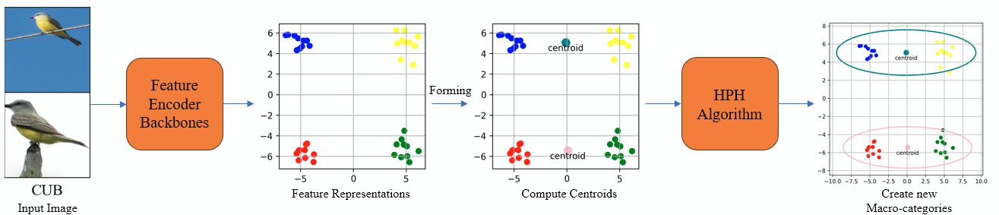

> Speaker note: K = number of images C = number of channel

## Slide 8: Soylocal heatmap

- Modified plot.py to add type_plot = heatmap to make the heatmap using seaborn

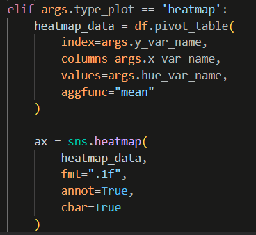

## Slide 9: Soylocal heatmap

- Highest mean accuracy is obtained at lr=1e-05, and second best at lr=0.01
- Ideal lr is usually around the middle accuracy in each optimizer
- Higher lr in each optimizer obtained terrible accuracy, consistent result from other dataset too

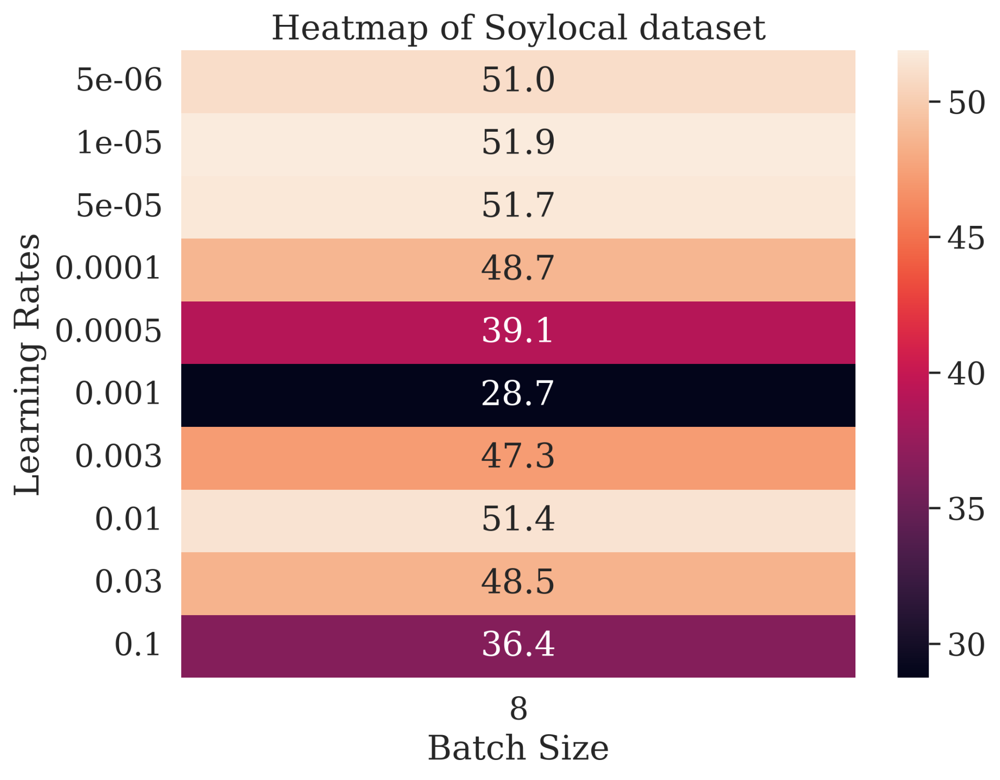

> Speaker note: It’s better in vertical :/

## Slide 10: Soylocal heatmap

- Other tha lr=5e-05, baseline for Soylocal consistently obtains lower results
- Higher cluster ratios, such as 70 or 90, obtains the highest accuracy for most lrs
- A more consistent trend of pseudo-hierarchy being better than baseline for Soylocal

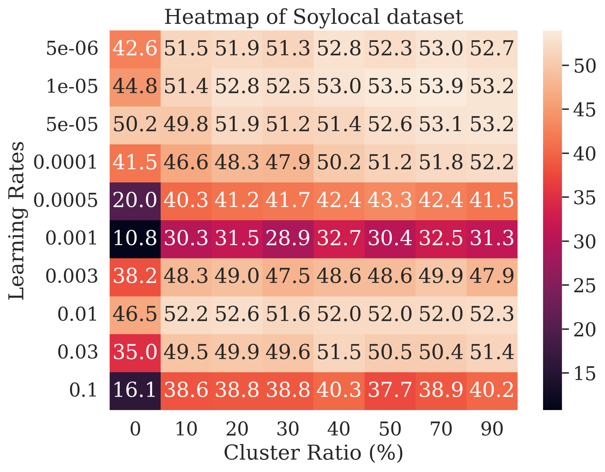

## Slide 11: Soylocal heatmap

- Best max accuracy is obtained by DeiT model and second next is by RN SwaV
- Many models max accuracy drops rather than increases

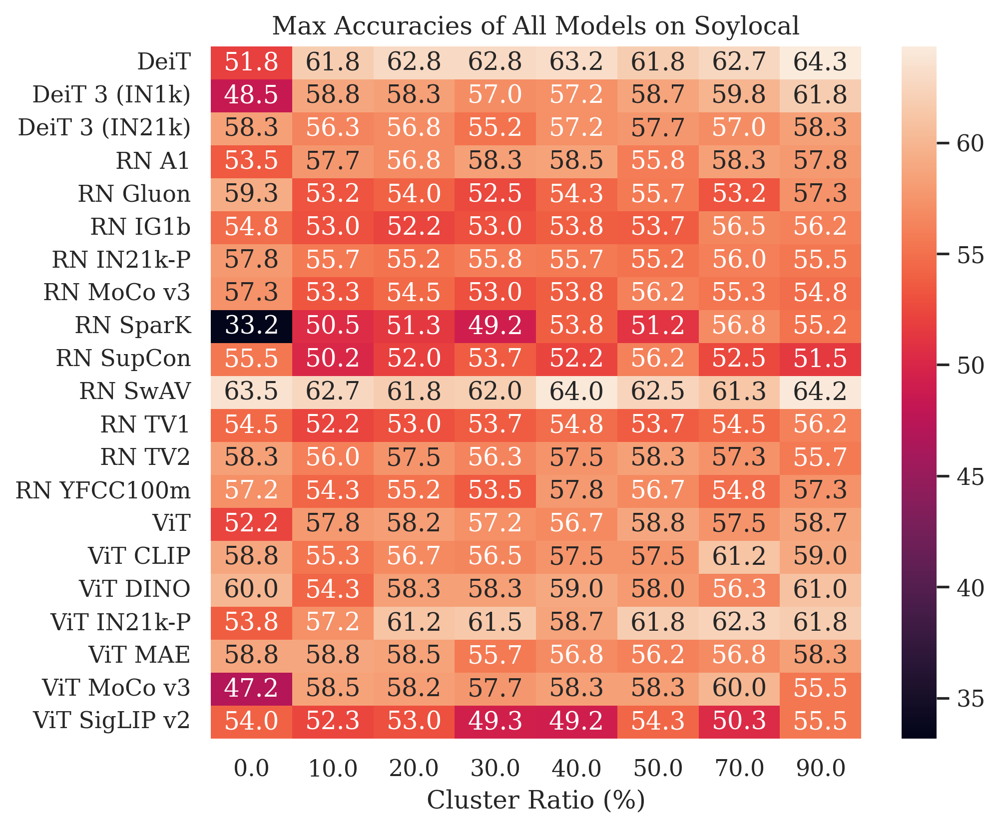
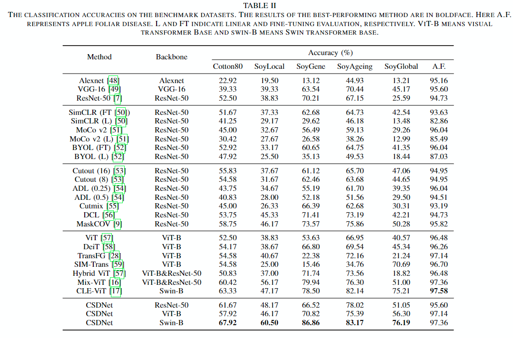

## Slide 12: Soylocal heatmap

- The mean accuracies show a clearer trend of improvement
- Most model shows improvement over the baseline mean accuracies

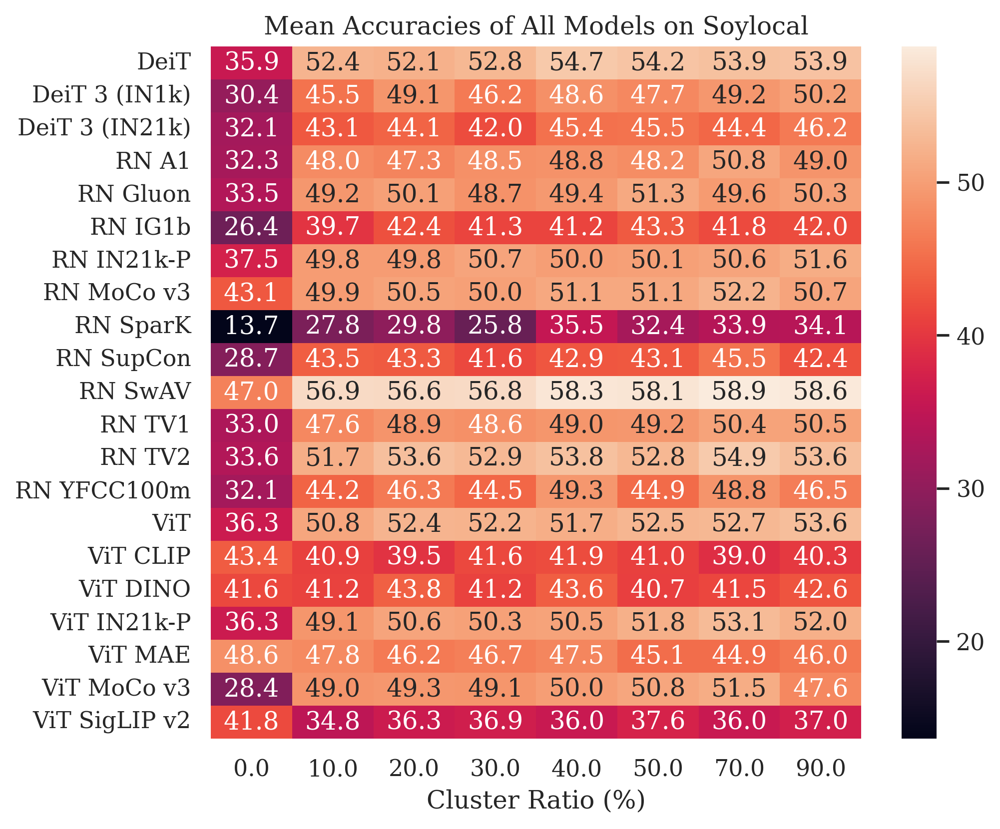

## Slide 13: Soylocal heatmap

- For DeiT, each LRs show consistent improvement over baseline
- Though, the improvement varies

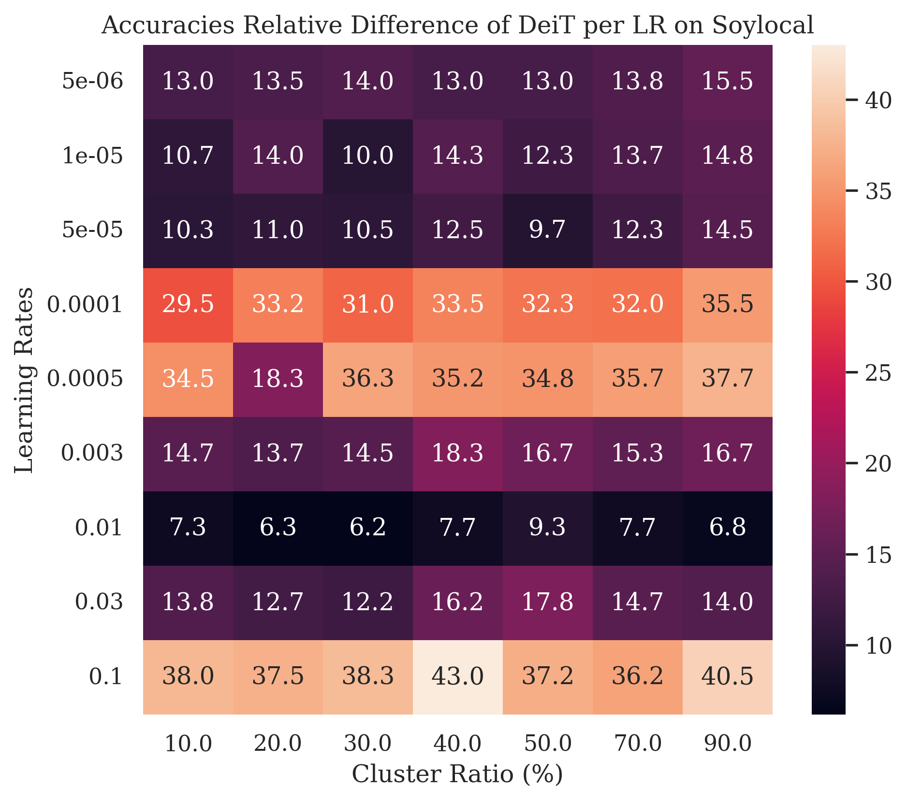
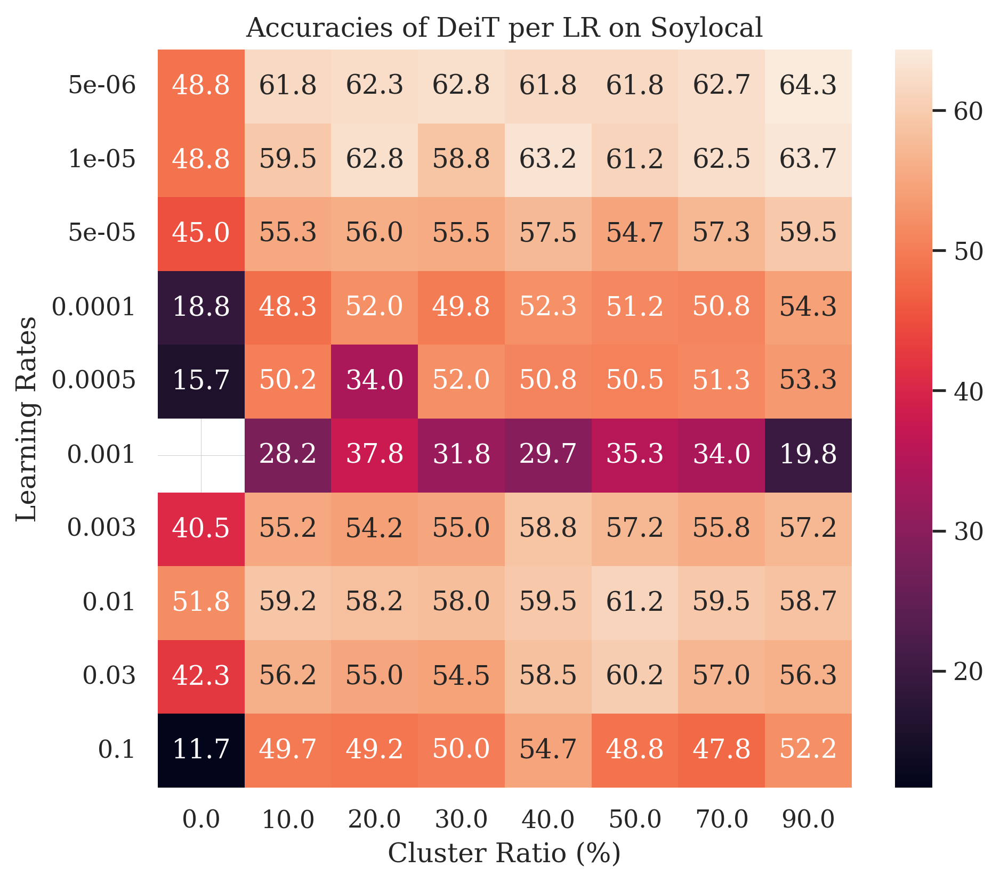

## Slide 14: Soylocal heatmap

- For SwaV, it mostly shows improvement over baseline other than LR = 0.0001
- With the best being in 1 particular LR

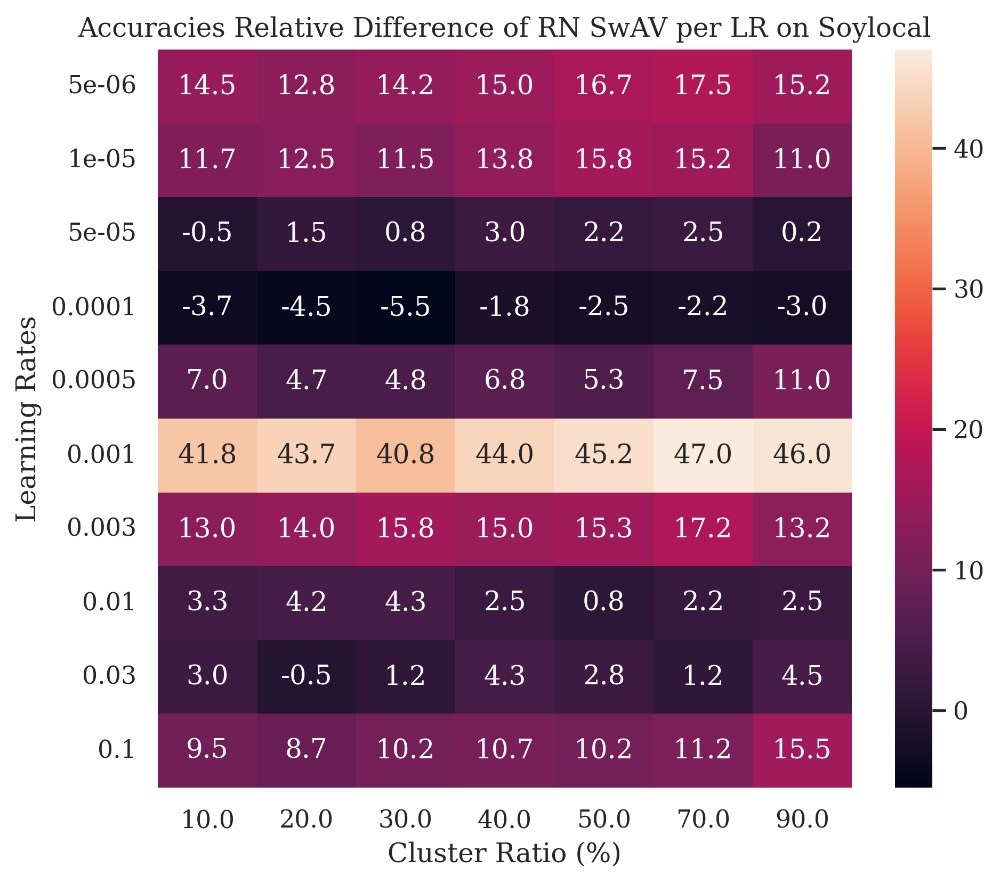
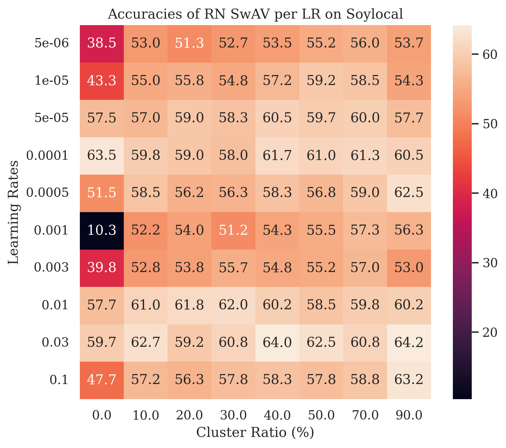

## Slide 15: Soylocal heatmap

- RN Mocov3, a contrastive learning model, best max accuracy is located in the baseline
- However, pseudo-hierarchy is more robust for LR

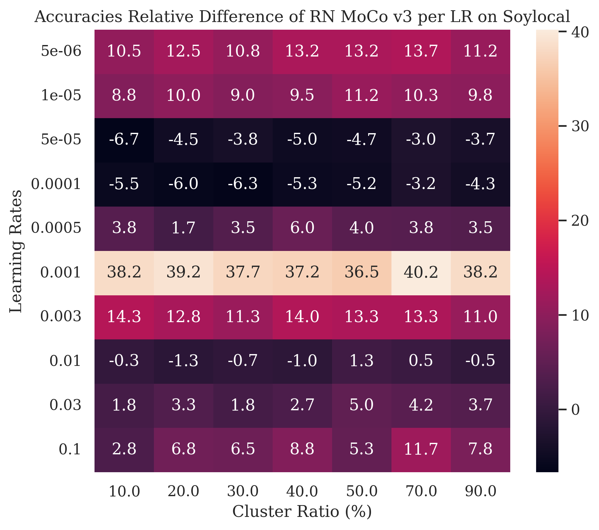
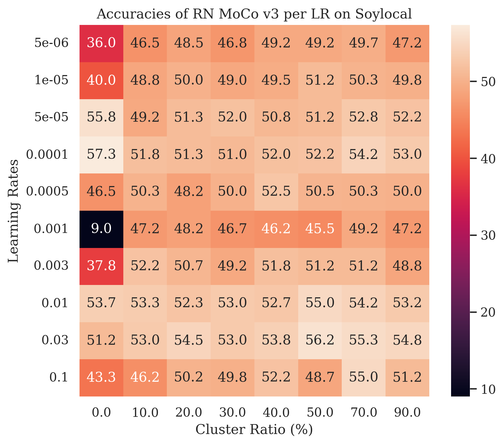
